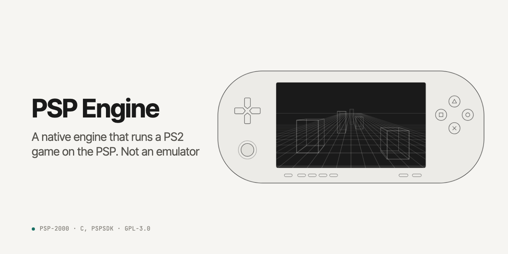

# SHAR-PSP

Open-source native PSP engine for *The Simpsons: Hit & Run*. Not an emulator, not decompiled code.
Shared as groundwork for the community: take it, build it, improve it.

No game files are included. The game data is converted from your own PS2 disc.

## Contents

- `viewer/` the PSP engine (C, PSPSDK)
- `tools/` converter from the PS2 disc to PSP packages, build and test scripts (Python, shell)
- `tests/` regression tests
- `docs/typography/` UI typography settings used by the converter

Comments are mostly in Russian.

## Build

1. `./setup.sh` installs the PSPDEV toolchain into `./pspdev`
2. `export PSPDEV=$PWD/pspdev PATH=$PWD/pspdev/bin:$PATH`
3. `cd viewer && psp-cmake -S . -B build && cmake --build build` builds `EBOOT.PBP`

Game data: unpack your own disc with [hit-and-run-web](https://github.com/Vheissu/hit-and-run-web) into
`hit-and-run-web/source/`, run `tools/build_level.sh` / `tools/ship.sh`, copy the result next to the EBOOT
in `PSP/GAME/SHARVIEW`. Tested on a PSP-2000 with custom firmware.

- Discs: PAL `SLES_518.97` and US NTSC `SLUS_206.24` (the executable is read from `SYSTEM.CNF`; NTSC movies are 640x448 at 29.97 fps
  and are resampled to the engine's 25 fps).
- `setup.sh` also creates `.venv` (Python 3.11+), installs the extra packages, the Homebrew libraries the macOS toolchain needs
  (`gmp libmpc mpfr zstd libusb`), ffmpeg (with the IPU decoder) and clones `donut` next to the engine.
- `tools/ship.sh` builds level 1 by default; all levels: `SHIP_LEVELS="2 3 4 5 6 7" caffeinate -i tools/ship.sh`.
- Sprites (coin, phone above the booth, wrench and its glow) are baked by the build from your own disc
  (`tools/sprites_bake.py`); the coin needs Blender (`BLENDER=/path/to/blender`), without it coins are drawn as 3D models.

Thanks to the first outside builder for the NTSC report and the build notes.

## Reporting bugs

The pause screen shows a map code in the bottom-left corner (like `L1 K9-7`). Put it in your issue,
so anyone can find the exact spot.

## Credits and references

- [donut](https://github.com/plowteam/donut), an open reimplementation of the game (GPL-3.0): formats and game logic reference
- [hit-and-run-web](https://github.com/Vheissu/hit-and-run-web) by Dwayne Charrington (MIT): PS2 disc format tools
- [The Simpsons: Hit & Run Wiki](https://simpsons-hit-and-run.fandom.com/wiki/The_Simpsons_Hit_and_Run_Wiki): game facts
- [Simpsons Wiki](https://simpsons.fandom.com/wiki/): every collectible card has a QR code that opens its episode page
- [@scenic_simpsons](https://www.instagram.com/scenic_simpsons/): frames from seasons 1–8 used to build the Cartoon mode palette
- PSP-2000 drawing on the cover: [PSP 2000 White](https://commons.wikimedia.org/wiki/File:PSP_2000_White.svg) by Paril (openclipart), CC0
- Pixel fonts by Patrick H. Lauke, [CC BY 3.0](http://creativecommons.org/licenses/by/3.0/):
  [Bart vs. the Space Mutants (16bit)](http://www.fontstruct.com/fontstructions/show/1363863),
  [The Simpsons](https://fontstruct.com/fontstructions/show/879452) (`assets/fonts/pixel`)

## License

GPL-3.0 for the code. Fonts keep their own CC BY 3.0 license. The leaked source of the original game was never used.
The Simpsons and The Simpsons: Hit & Run are trademarks of their respective owners. Non-commercial fan project.
